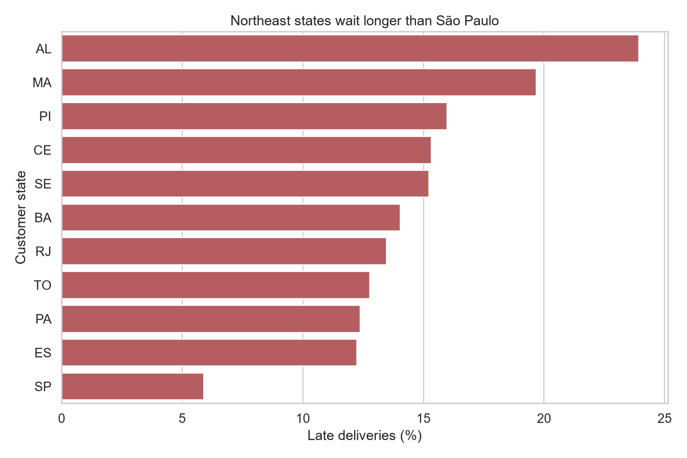
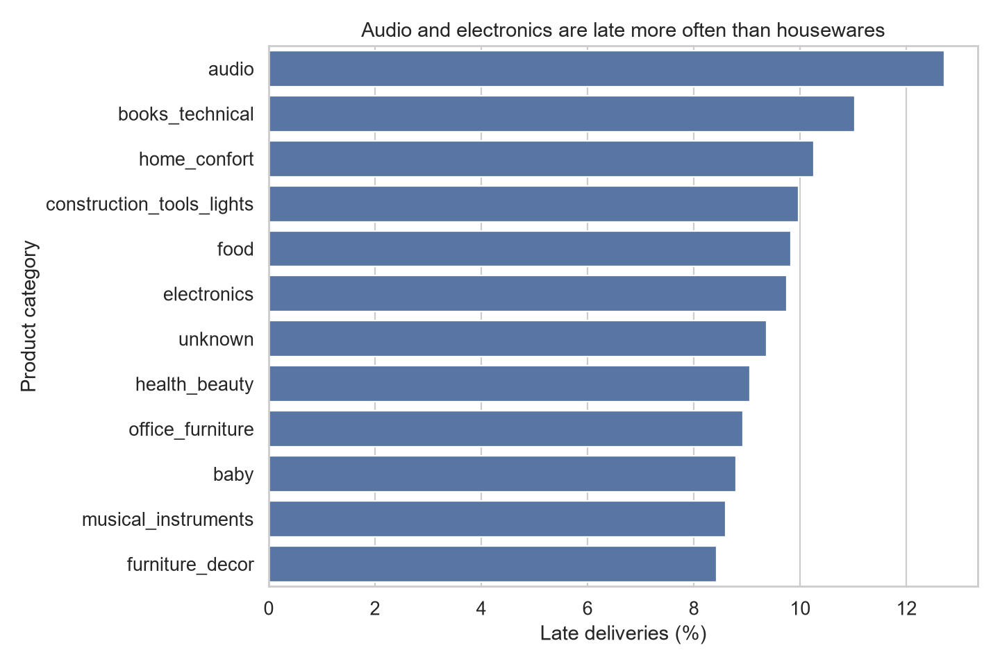
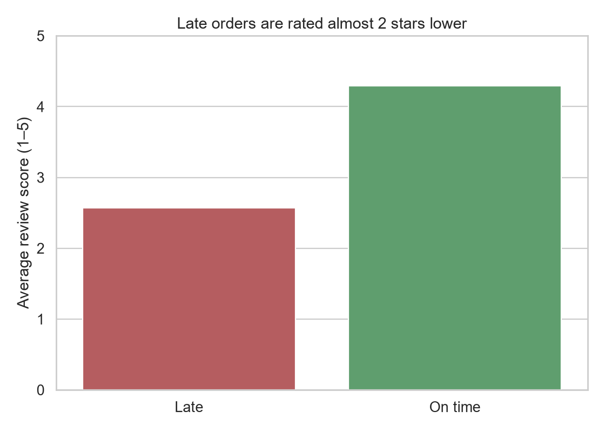

# Which Olist deliveries arrive late?

I used the public [Olist Brazilian e-commerce](https://www.kaggle.com/datasets/olistbr/brazilian-ecommerce) orders to answer three questions:

1. How often is a delivered order actually late?
2. Which **states** and **product categories** are late the most?
3. Do late orders get **worse review scores**?

I loaded the CSVs into a local PostgreSQL database, wrote the analysis in SQL, and made the charts in Python.

## What I found

**8.11% of delivered orders were late** — 7,826 late out of 96,470 delivered orders that have an arrival date.

I called an order late when `order_delivered_customer_date` is after `order_estimated_delivery_date`. I ignored cancelled / undelivered rows, because there is nothing to compare.

**States.** Northeast customers wait the longest. Alagoas (AL) is late **23.9%** of the time, Maranhão (MA) **19.7%**. São Paulo (SP) is only **5.9%**, even though it has the most orders (about 40k). Rio de Janeiro (RJ) is a high-volume problem: **13.5%** late on 12k orders.

**Categories.** The gap between categories is smaller than the gap between states. Audio is worst among categories with enough items (**12.7%**), then technical books and home comfort. Housewares and some furniture land closer to **6%**. So **where the customer lives looks more important than what they bought**.

**Reviews.** This is the strongest result. Late orders average **2.57 / 5** stars. On-time orders average **4.29 / 5**. Same 1–5 scale, almost a two-star drop.







## How I would use this

If I were Olist I would not start by tweaking product pages. I would look at **shipping to AL / MA / PI / CE / SE / BA**, and at **Rio** because the volume is large. The review gap says lateness is not a small annoyance — it shows up in the score the customer leaves.

## What this does not prove

- I only scored **delivered** orders. Packages that never arrived are a different problem.
- Category stats count **items**, not unique orders. One late order with two products is counted twice.
- A low review on a late order might also be about a bad product, not only the wait.
- The estimated date already has some buffer in it. “Late vs the promise” is not the same as “slow vs physics”.

## Project layout

```
sql/01_late_orders.sql        overall late rate
sql/02_late_by_state.sql      late rate by customer state + rank
sql/03_late_by_category.sql   late rate by product category + rank
sql/04_late_vs_reviews.sql    average stars for late vs on time
charts.py                     pandas + seaborn charts
figures/                      pngs used in this README
```

Each SQL file has comments for why I wrote it that way.

## How to run this

You need PostgreSQL with the Olist CSVs loaded into a database named `olist` (host `localhost`, port `2008` on my machine).

1. Copy `.env.example` to `.env` and put your password in the URL.
2. Install packages: `py -3 -m pip install -r requirements.txt`
3. Open any file in `sql/` in pgAdmin and run it on the `olist` database.
4. Or run `py -3 charts.py`. It reads the SQL files and redraws the charts.

I did **not** put the CSV files in this repo. Download them from Kaggle if you want to rebuild the database.
